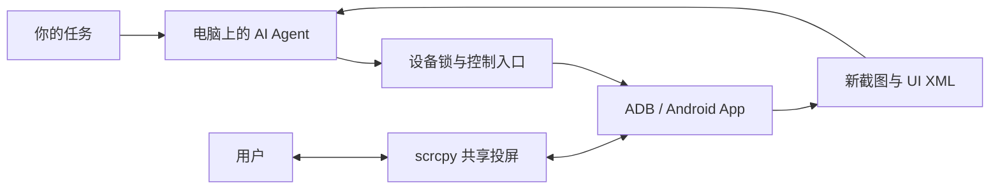

# Mi-pad Agent

**把 Android 平板变成电脑上 AI Agent 的操作终端。**

连接自己的手机或平板，即可让具有终端、文件和图片读取能力的 AI Agent 读取界面、点击、滑动、运行 App 和保存操作证据。你可以在投屏窗口随时点击协助。核心是 Python 标准库、ADB、scrcpy，以及一套实际执行的设备互斥锁与操作约定。

本仓库是可复刻的基础控制工具包，需配合使用者自己的 AI Agent。它不包含模型服务、API 额度、App 账号或云端控制后台。设备通过 USB 接到执行 Agent 的电脑；下载链接不会远程接管另一台电脑或本项目原设备。

## 把链接发给别人

把下面这段话连同仓库链接交给对方电脑上的 AI Agent：

> 请克隆 https://github.com/BoyangGuo1789/mi-pad-agent ，先阅读 README.md、AGENTS.md 和 docs/SETUP.md，检查我的电脑环境并安装缺失的官方依赖。我会连接自己的 Android 设备并完成 USB 调试授权。请生成本机配置，运行 doctor 和基础验收，确认截图、UI 读取、唤醒与设备锁可用，最后打开共享投屏。不要创建业务定时任务或操作购物、考勤、消息；先向我报告验收结果。

完整交接提示词见 [START_HERE_PROMPT](examples/START_HERE_PROMPT.md)。

## 可以复刻什么

| 能力 | 入口 | 说明 |
|---|---|---|
| 连接检查与设备选择 | `devices`、`setup`、`doctor` | 自动选唯一已授权设备；多设备必须明确选择 |
| 多个 Agent 互斥操作 | `acquire`、`renew`、`release`、`status` | 同一主机、同一系统用户、同一 serial 共用实际进程锁 |
| 唤醒与回到桌面 | `wake` | 核验锁屏与前台；有密码时由用户自行解锁 |
| 读取界面与保存证据 | `capture` | 保存新的 XML 和 PNG；拒绝覆盖旧文件 |
| 点击、滑动、按键、启动 App | 持锁的 `adb` | Agent 每次先读新页面，再决定动作 |
| 共享投屏 | `observe` | 用户可随时点击和输入；AI 之间仍互斥 |
| 信息搜集与固定流程 | [任务示例](docs/RECIPES.md) | 依赖具体 App 的登录、页面和用户授权 |

## 快速开始（macOS）

准备 Python 3.10+、Git、ADB 和 scrcpy。有 Homebrew 的电脑可运行：

```bash
brew install python git scrcpy
brew install --cask android-platform-tools
git clone https://github.com/BoyangGuo1789/mi-pad-agent.git
cd mi-pad-agent
```

在自己的 Android 设备上打开开发者选项和 USB 调试，用数据线连接，在设备弹窗中授权这台电脑。然后运行：

```bash
bash scripts/bootstrap.sh
python3 examples/smoke_test.py
python3 scripts/tablet_control.py observe
```

`bootstrap.sh` 只检查工具、选择设备并生成本机配置，不安装系统软件。验收会唤醒设备、返回桌面、采集截图及 UI XML，随后释放锁。成功时显示 `"ok": true` 和 `"lease_released": true`。投屏是前台进程，关闭窗口结束。

**Linux / Windows：** 原生运行支持 macOS 和 Linux；Windows 需使用 WSL2 + USB 转接，当前未做 Windows 真机验收。各系统完整步骤、缺依赖和离线排查见 [安装指南](docs/SETUP.md)。

## 怎么让 Agent 操作

打开仓库作为 Agent 的工作目录，告诉它本次任务。它先读 [AGENTS.md](AGENTS.md)，领取设备锁，确认当前界面，逐步执行、核验并释放锁。命令示例与 Python 用法见 [操作接口](docs/USAGE.md)。



这里复制的是基础操作方法。任意 App 的无人值守成功率、自动中文输入、支付或考勤流程需要独立适配和验收。默认不创建任何周期任务；不会搬运原项目的账号、订单、位置、考勤计划或历史截图。

## 验证与开发

```bash
python3 -m unittest discover -s tests -v
```

测试使用临时状态目录和模拟 ADB，不连接真实设备。发布验证范围见 [VERIFICATION](docs/VERIFICATION.md)。

| 文件 | 内容 |
|---|---|
| [AGENTS.md](AGENTS.md) | AI 操作约定 |
| [scripts/tablet_control.py](scripts/tablet_control.py) | 设备锁和控制入口 |
| [scripts/config.py](scripts/config.py) | 本机配置、设备发现及环境检查 |
| [examples/smoke_test.py](examples/smoke_test.py) | 持锁的真机基础验收 |
| [Open-Mirror.command](Open-Mirror.command) | macOS 双击打开共享投屏 |
| [docs/INDEX.md](docs/INDEX.md) | 文档导航 |

代码采用 [MIT 许可](LICENSE)。ADB 与 scrcpy 由使用者从官方渠道安装，各自许可证不变。
